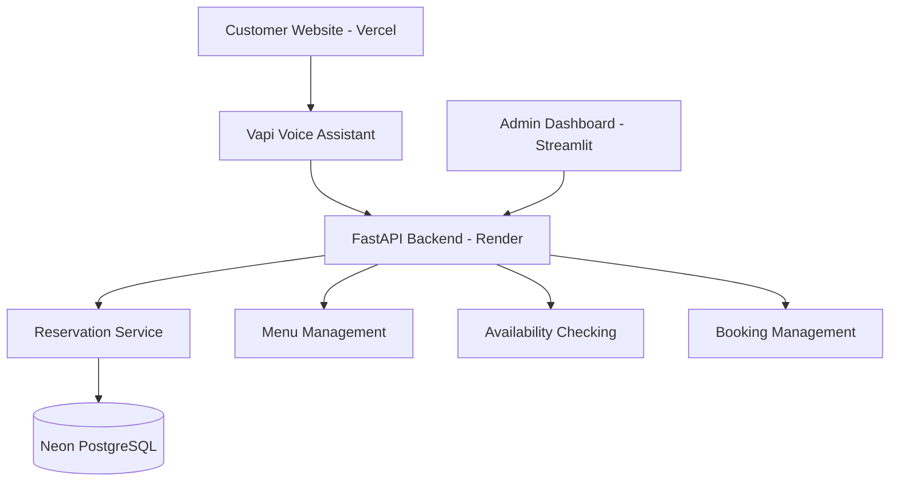

# 🍽️ RestaurantVoiceAI – AI-Powered Restaurant Voice Assistant

An intelligent, multilingual AI voice assistant that automates restaurant operations, handles customer queries, checks table availability, and manages reservations through natural voice conversations.

Built using **Python, FastAPI, Vapi, PostgreSQL, Streamlit, and AI-powered voice automation**.

<p align="center">

  **AI Voice Agent | Smart Reservations | Real-Time Backend | Admin Dashboard**

</p>

---

## 🚀 Project Overview

RestaurantVoiceAI is an AI-powered restaurant receptionist designed to automate customer interactions and reservation management.

Customers can interact with the voice assistant in Hindi or English to:

- Explore the restaurant menu.
- Ask questions about food items and prices.
- Check real-time table availability.
- Book restaurant tables through voice conversations.
- Cancel existing reservations.
- Interact naturally without manual receptionist assistance.

Restaurant administrators can manage reservations through a dedicated Streamlit dashboard.

The system connects a customer-facing website, AI voice assistant, FastAPI backend, and PostgreSQL database into one integrated application.

## ✨ Key Features

### 🎙️ AI Voice Assistant
- Multilingual voice interactions (Hindi and English).
- Natural conversational experience.
- AI-powered restaurant receptionist.
- Voice-based menu assistance.
- Automated reservation handling.
- Vapi integration for real-time voice conversations.

### 📅 Smart Reservation Management
- Real-time table availability checking.
- Automated table allocation.
- Reservation creation and cancellation.
- Configurable reservation duration.
- Reservation status tracking.
- Database-backed reservation management.

### 🛠️ Admin Dashboard
- Secure admin authentication.
- View all restaurant reservations.
- Monitor total reservations.
- Track confirmed and cancelled bookings.
- Filter reservations by status.
- Cancel existing bookings.
- Refresh reservation records.

### 🌐 Customer Website
- Customer-facing restaurant website.
- Integrated AI voice assistant.
- Easy access to restaurant voice services.
- Backend-connected reservation workflow.

### ☁️ Cloud Deployment
- FastAPI backend deployed on Render.
- PostgreSQL database hosted on Neon.
- Streamlit admin dashboard deployed on Streamlit Community Cloud.
- Customer website deployed on Vercel.
- Vapi connected to the production backend.

---

## 🏗️ System Architecture



### Architecture Explanation

1. Customers access the restaurant website.
2. Vapi provides the AI-powered voice interaction.
3. Vapi calls FastAPI endpoints through webhook tools.
4. FastAPI processes customer requests.
5. Reservation services check availability and manage bookings.
6. Neon PostgreSQL stores reservation and restaurant data.
7. Administrators manage bookings through Streamlit.

---

## 🧰 Tech Stack

| Category | Technologies |
|---|---|
| Programming Language | Python |
| Backend Framework | FastAPI |
| Voice AI Platform | Vapi |
| Database | PostgreSQL |
| Database Hosting | Neon |
| ORM | SQLAlchemy |
| Admin Dashboard | Streamlit |
| Frontend | HTML, CSS, JavaScript |
| Backend Deployment | Render |
| Frontend Deployment | Vercel |
| Admin Deployment | Streamlit Community Cloud |
| API Testing | FastAPI Swagger UI |
| Development Tools | Git, GitHub, VS Code |

---

## 🔧 Core Vapi Function Tools

The voice assistant uses four backend-integrated function tools:

| Tool | Description |
|---|---|
| `get_menu` | Retrieves restaurant menu information |
| `check_table_availability` | Checks available tables for a requested reservation |
| `book_table` | Creates a restaurant reservation |
| `cancel_booking` | Cancels an existing reservation |

These tools allow the AI assistant to perform actual backend operations rather than simply generating conversational responses.

---

## 📂 Project Structure

```text
RestaurantVoiceAI/
│
├── backend/
│   ├── main.py
│   ├── database.py
│   ├── models.py
│   ├── restaurant_models.py
│   ├── schemas.py
│   ├── admin_security.py
│   │
│   └── services/
│       └── reservation_service.py
│
├── frontend/
│   ├── customer/
│   │   ├── index.html
│   │   ├── style.css
│   │   └── script.js
│   │
│   └── admin_app.py
│
├── requirements.txt
├── .env.example
├── .gitignore
└── README.md
```

---

## ⚙️ Local Installation and Setup

### 1. Clone the Repository

```bash
git clone https://github.com/siddhant754962/RestaurantVoiceAI.git
```

```bash
cd RestaurantVoiceAI
```

### 2. Create Virtual Environment

```bash
python -m venv .venv
```

Activate on Windows:

```powershell
.venv\Scripts\Activate.ps1
```

### 3. Install Dependencies

```bash
pip install -r requirements.txt
```

### 4. Configure Environment Variables

Create a `.env` file in the project root.

Example:

```env
DATABASE_URL=your_postgresql_connection_string

GROQ_API_KEY=your_groq_api_key

VAPI_API_KEY=your_vapi_api_key

ADMIN_USERNAME=your_admin_username

ADMIN_PASSWORD=your_strong_admin_password

BACKEND_URL=http://127.0.0.1:8000
```

Add any additional environment variables required by your configured services.

**Security:** Never upload `.env` or API keys, database credentials, or passwords to GitHub.

### 5. Start FastAPI Backend

```bash
uvicorn backend.main:app --reload
```

Backend:

```text
http://127.0.0.1:8000
```

API Documentation:

```text
http://127.0.0.1:8000/docs
```

### 6. Start Admin Dashboard

```bash
streamlit run frontend/admin_app.py
```

### 7. Run Customer Website

Open:

```text
frontend/customer/index.html
```

You can also serve the customer folder using a local static web server.

---

## ☁️ Production Deployment

The application is deployed using the following services:

| Component | Platform |
|---|---|
| Backend API | Render |
| PostgreSQL Database | Neon |
| Admin Dashboard | Streamlit Community Cloud |
| Customer Website | Vercel |
| Voice Assistant | Vapi |

### Backend Deployment

Render Start Command:

```bash
uvicorn backend.main:app --host 0.0.0.0 --port $PORT
```

### Production Webhook

```text
https://restaurantvoiceai.onrender.com/vapi/webhook
```

Configure the Vapi server URL to point to your deployed backend webhook.

### Environment Configuration

Configure production credentials through the hosting platform's environment variable settings.

Do not store production secrets in source code.

---

## 🧪 Testing

The following core workflows have been tested:

- [x] Restaurant menu retrieval.
- [x] Table availability checking.
- [x] Reservation creation.
- [x] Reservation cancellation.
- [x] Vapi function tool integration.
- [x] FastAPI backend deployment.
- [x] Neon PostgreSQL connection.
- [x] Admin dashboard reservation synchronization.
- [x] Customer website deployment.
- [x] Hindi and English voice interactions.


## 🌐 Live Demo

- **Customer Website:** https://restaurantvoiceai-customer.vercel.app/
- **Admin Dashboard:** https://restaurantvoiceai-65jqltav5gs5m3rsfmttzg.streamlit.app/
- **Backend API:** https://restaurantvoiceai.onrender.com/docs
- **GitHub Repository:** https://github.com/siddhant754962/RestaurantVoiceAI
---

## 🔐 Security Considerations

- Admin dashboard protected with authentication.
- Sensitive credentials stored in environment variables.
- Database connection managed through configuration.
- API credentials are not included in the repository.
- Backend endpoints handle reservation operations.

---

## 💡 Future Enhancements

- WhatsApp reservation confirmations.
- Automated email notifications.
- Advanced restaurant analytics.
- Daily reservation reports.
- Multi-restaurant management.
- Customer booking history.
- Restaurant opening-hour validation.
- Advanced monitoring and logging.
- Improved reservation evaluation and testing.

---

## 👨‍💻 Author

**Siddhant Kumar Patel**

B.Tech – Information Technology

Interested in Generative AI, Agentic AI, AI Engineering, and Full-Stack AI Applications.

### Connect With Me

- GitHub: https://github.com/siddhant754962
- LinkedIn: Add your LinkedIn profile URL
- Portfolio: Add your portfolio URL

---


## ⭐ Support

If you find this project interesting, consider giving the repository a ⭐ on GitHub.

**RestaurantVoiceAI – Making Restaurant Reservations Smarter with AI Voice Automation.**
